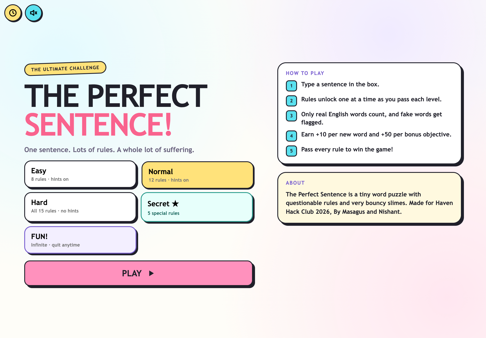

# The Perfect Sentence!

Create the perfect sentences, battling the rules and the slimes!

Made for **Haven Hack Club 2026** (Abu Dhabi) by **Masagus** and **Nishant**.

---

## How to play

1. Pick a difficulty and hit **PLAY**.
2. Type one sentence in the box.
3. Rules unlock one at a time as you pass each one.
4. Only real English words count. Some of your 'unique' words may not be in the dictionary, so be OPEN MINDED.
5. Clear every rule to win — or quit anytime in **FUN** mode.

**Scoring**

- **+10** per new unique real word
- **+50** per completed bonus objective

---

## Difficulties

| Mode | Rules | Hints |
|------|-------|-------|
| **Easy** | 8 | On |
| **Normal** | 12 | On |
| **Hard** | 15 | Off |
| **Secret ★** | Try it for yourselves... | On |
| **FUN!** | ∞ | — |

### FUN!

No rules. Write anything, score real words, hit **QUIT & SAVE** when you’re done.

---

## Features

- Progressive rule unlock with live checklist
- Bonus objectives for more points
- Optional music and sound effects
- Draggable, wandering slimes (click to kick)
- Optional chiptune music (Web Audio, no audio files)
- **Win history** — clock button (top-left) stores wins in `localStorage` (mode, sentence, score, time)

---

## Tech

Single static HTML file:

- HTML + CSS + vanilla JavaScript
- No frameworks, no dependencies
- Offline dictionary via `DecompressionStream` + embedded gzip payload
- Wins persisted with `localStorage` key `perfectSentenceWins`

---

## Play Offline

Download the html file and open it in your browser to play the game offline.

- 1. Download the html file
- 2. Open it in your browser
- 3. Click **PLAY** 
- 4. Start typing sentences!

---

PS: Have fun :D

Nishant and Masagus

